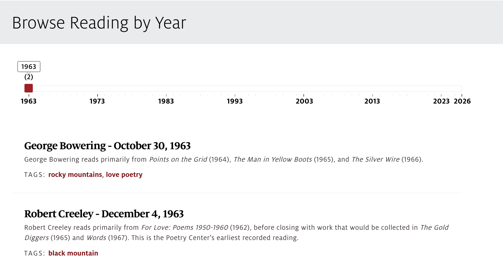
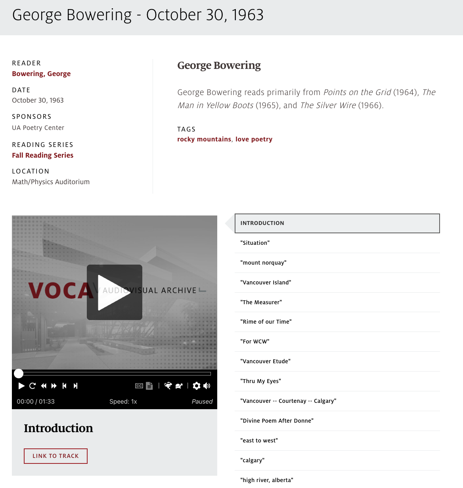
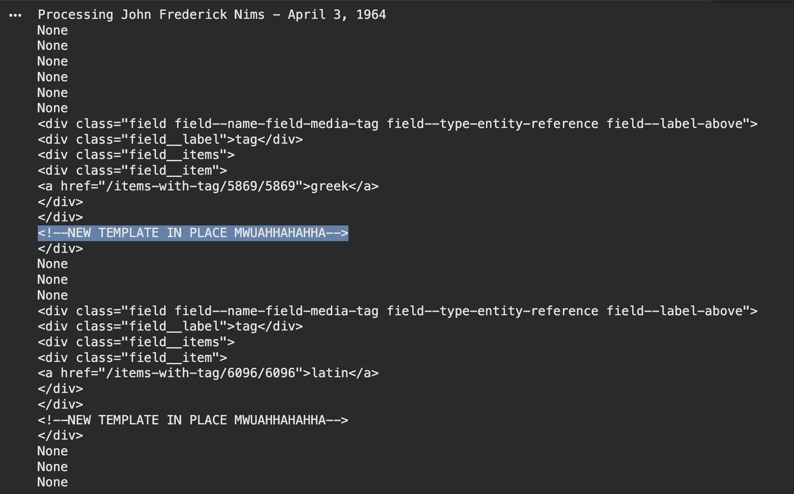
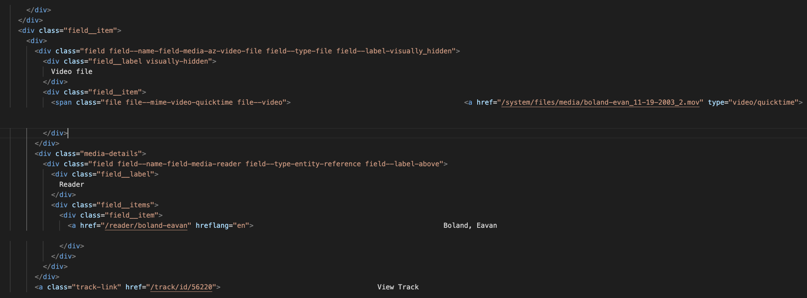

## Introduction

Web scraping provides an unconventional approach to engaging with metadata. It challenges assumptions about what data looks like and what data exists. This particular document highlights the unexpected outcomes that came from web scraping Voca in Python, using the Beautiful Soup library.

First, the Readings by Year list was scraped to get a link to every reading in Voca. This was relatively straightforward.

After obtaining links to every reading in Voca, more details for each reading can be accessed by going to the detailed reading pages, which contain the multimedia viewer, additional information about the reading, and track breakdown. This process came with surprising results.

## Data

As of Oct 18, 2026, there are 1163 readings in Voca. 88 of these readings do not have any tags.

There are 11479 tracks across the readings. A track is a segment of a reading. The majority of them do not have any tags. Track-level tags became more frequent beginning around 2021. Oftentimes, the tags given to the tracks are not the same as the ones given to the readings.

Most of the tracks can be broadly categorized as follows:
- Introduction: Someone introduces the reader.
- Welcome: The reader says something about the collection they will read from.
- Work: The piece of writing that is being read from. Usually, this is a poem.
- Work Context: This includes how the reader understands the poem, and history to help the audience understand the poem.
- Q&A: A moderator and the reader(s) talk about the writing process

There are around 130 readings not properly broken down into tracks due to budget constraints and remain as "Full Reading".

Some tracks, or even entire readings, do not have captions and instead contain a placeholder description to meet with Voca. They are listed below.

Tracks without captions

| Reading | Track |
| :--- | :--- |
| James Tate - November 20, 1968 | Question and Answer Session |
| Mona Van Duyn - November 2, 1978 | "The Miser" |
| John Ashbery - September 12, 1990 | "Autumn Telegram" |
| John Ashbery - September 12, 1990 | "Korean Soap Opera" |
| John Ashbery - September 12, 1990 | Excerpt from Flow Chart |
| Heriberto Yépez - April 25, 2004 | On Latin American culture and language since the Spanish conquest |
| Heriberto Yépez - April 25, 2004 | On the influence of Jorge Luis Borges |
| Heriberto Yépez - April 25, 2004 | On Pablo Palacio, Luis Cardoza y Aragón, Augusto Monterroso, and Mario Bellatin |
| Heriberto Yépez - April 25, 2004 | On identity and conservatism in the Mexican literary tradition and translation |
| Heriberto Yépez - April 25, 2004 | On contemporary indigenous literature, los contemporales, and Cantinflas |
| Heriberto Yépez - April 25, 2004 | On Mario Bellatin, Cristina Rivera-Garza, humor, gender, and performance in the experimental novel |
| Heriberto Yépez - April 25, 2004 | On performance art and feminism, and the influence of U.S. poetics in Mexico after NAFTA and 9/11 |
| Heriberto Yépez - April 25, 2004 | On the uses of politically incorrect humor and authorial persona |
| Heriberto Yépez - April 25, 2004 | On the reception of Chicano literature and border literature by American and Mexican academies |
| Heriberto Yépez - April 25, 2004 | On class, gender, and the border in the literary/cultural establishment |
| Brian Turner - October 26, 2006 | Welcome |
| Carmen Giménez Smith - April 25, 2013 | Introduction |
| Eduardo C. Corral - September 5, 2013 | Introduction |
| Tongo Eisen-Martin - October 17, 2019 | Welcome |
| Tongo Eisen-Martin - October 17, 2019 | Sustainable Nations |
| Tongo Eisen-Martin - October 17, 2019 | Introduction |
| Tongo Eisen-Martin - October 17, 2019 | "Knees Next to Their Wallets" |
| Tongo Eisen-Martin - October 17, 2019 | "Chemical Extradition" |
| Tongo Eisen-Martin - October 17, 2019 | "A Good Consciousness" |
| Tongo Eisen-Martin - October 17, 2019 | "No Stars Over the Trenches Tonight" |
| Tongo Eisen-Martin - October 17, 2019 | "Lower-Class Artist Imagines" |
| Tongo Eisen-Martin - October 17, 2019 | "Factory of Wrists" |
| Tongo Eisen-Martin - October 17, 2019 | "Two Sides Fight" |
| Tongo Eisen-Martin - October 17, 2019 | "I Make Promises Before I Dream" |
| Tongo Eisen-Martin - October 17, 2019 | "A Sketch About Genocide" |
| Tongo Eisen-Martin - October 17, 2019 | "Apologies, Lord" |
| Tongo Eisen-Martin - October 17, 2019 | "The Suburbs Are Finally Offended" |
| Tongo Eisen-Martin - October 17, 2019 | "I Imitate You" |
| Tongo Eisen-Martin - October 17, 2019 | "Clocked In Still Starving" |
| Tongo Eisen-Martin - October 17, 2019 | Excerpts from "Heaven Is All Goodbyes" and "someone's dead already" |
| Tongo Eisen-Martin - October 17, 2019 | Question and Answer Session |
| Matthew Zapruder - November 7, 2019 | Excerpt from "Why Poetry" (1) |
| Matthew Zapruder - November 7, 2019 | "Father's Day" |
| Matthew Zapruder - November 7, 2019 | Question and Answer Session |
| Cecilia Vicuña with Rosa Alcalá and Daniel Borzutzky - January 28, 2023 | Welcome on behalf of MOCA Tucson and Introductions |
| Cecilia Vicuña with Rosa Alcalá and Daniel Borzutzky - January 28, 2023 | Welcome on behalf of the Poetry Center |
| Cecilia Vicuña with Rosa Alcalá and Daniel Borzutzky - January 28, 2023 | Opening Remarks and Excerpt from The Deer Book |
| Cecilia Vicuña with Rosa Alcalá and Daniel Borzutzky - January 28, 2023 | "The Devouring Economy of Nature" |
| Cecilia Vicuña with Rosa Alcalá and Daniel Borzutzky - January 28, 2023 | "Utopia, 527 and 528" |
| Cecilia Vicuña with Rosa Alcalá and Daniel Borzutzky - January 28, 2023 | "Performance of Becoming Human, #1025: The Police or the Bank of America" |
| Cecilia Vicuña with Rosa Alcalá and Daniel Borzutzky - January 28, 2023 | Excerpt from Hallwalls Contemporary Arts Center, Buffalo, NY, 1998 |
| Cecilia Vicuña with Rosa Alcalá and Daniel Borzutzky - January 28, 2023 | "To Hear Is To Strike Gold: A Response to Pascua Lama" |
| Cecilia Vicuña with Rosa Alcalá and Daniel Borzutzky - January 28, 2023 | "The Tree" |
| Cecilia Vicuña with Rosa Alcalá and Daniel Borzutzky - January 28, 2023 | "Would You" |
| Cecilia Vicuña with Rosa Alcalá and Daniel Borzutzky - January 28, 2023 | Opening Remarks and Excerpt from Hallwalls Contemporary Arts Center, Buffalo, NY, 1998 |
| Cecilia Vicuña with Rosa Alcalá and Daniel Borzutzky - January 28, 2023 | Excerpt from Krannert Art Center, University of Illinois at Urbana-Champaign, 1999 |
| Cecilia Vicuña with Rosa Alcalá and Daniel Borzutzky - January 28, 2023 | Discussion |

Some tracks are missing a reader. They are listed below.

Tracks without reader

| Reading | Track |
| :--- | :--- |
| An Evening with Raquel Salas Rivera, Sin à Tes Souhaits (Frank Johnson), and Vanessa Angélica Villarreal - February 18, 2021 | "Cenex le escribió un poema a Fanon sin cárceles, sin policías, sin gringos/Cenex wrote Fanon a poem without prisons, without cops, without gringos" |
| Like A Hammer: Poets on Mass Incarceration - March 20, 2025 | Welcome |
| Like A Hammer: Poets on Mass Incarceration - March 20, 2025 | Introduction |

Some tracks appear in more than one reading. This appears intentional most of the time, as one reading may be split up by reader, and thus can share introductory remarks.

However, there is one reading in which it appears to be an error: the "David Dominguez - February 2, 2005" reading appears twice in the years list, on pages [10](https://voca.arizona.edu/browse-by-year?page=10) and [11](https://voca.arizona.edu/browse-by-year?page=11). It is believed that one of those readings should have belonged to [Brenda Shaughnessy](https://voca.arizona.edu/reading/brenda-shaughnessy-february-2-2005). We removed the 9 extra tracks pertaining to the duplicate David Dominguez reading when processing the tracks in our visualizations.

## Surprises in Data

Looking at the file formats also yields insights about technological change in the Poetry Center. From the earliest Voca recordings to 2001, MP3 files were used for audio. Beginning with Dana Levin's March 2000 reading, M4V files emerge as the audio format. Primarily M4V files would be used, though there was the occasional MP3 recording until the early 2010s. The Nicole Sealey reading in 2021 was the first to use MP4 file format. M4V is the Apple variant of the MP4 audiovisual file format.

Sometimes the unseen aspects of the code tell us about design decisions.
John Frederick's 1964 reading was the first one in Voca that used a template that allowed tags on a track granularity, as opposed to only on the reading granularity. The excitement for this affordance is communicated in a comment in the HTML.

Eavan Boland's 2003 reading contains a malformed template issue, where a section is made for additional tracks, but as of now there's only one track, the “Full Reading.” There's supposedly a .mov file associated with a second track for the reading. This issue was detected by a failure in parsing the item (no track title) when web scraping the specific readings page.

## Code and Ethics

The code used for web scraping can be found in our Github repository.

Web scraping can put substantial load on a web server and the contents may be subject to copyright. We had the permission of the Poetry Center to scrape Voca.